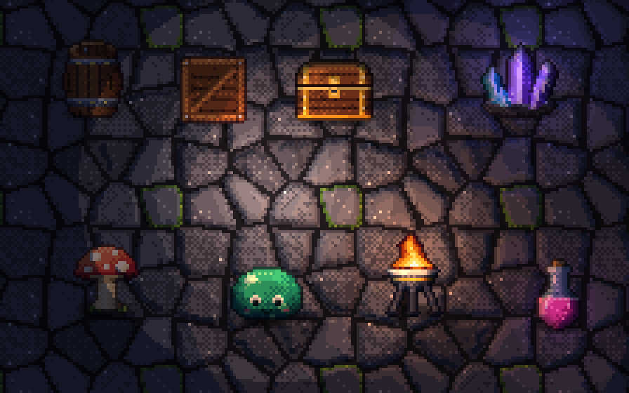
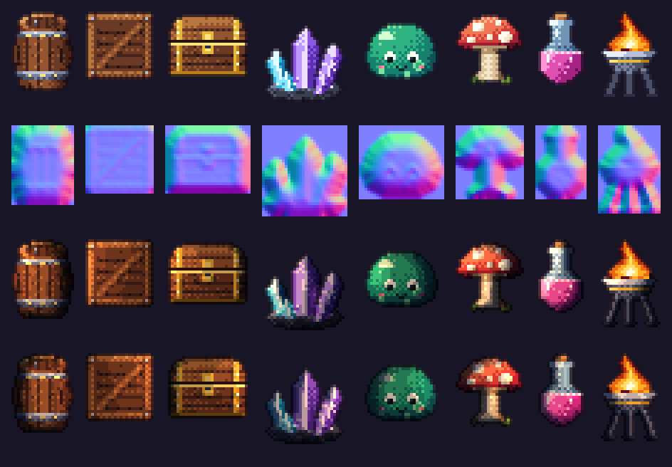

# Pixel Art Normal Map Lab

[日本語](README.md) | **English**

A browser lab that generates normal maps for pixel art **from the outline (silhouette) alone** and lights them in real time with 2D point lights.
It implements the technique described in [SpriteCook's blog post "Pixel Art Normal Maps from the Outline"](https://www.spritecook.ai/blog/pixel-art-normal-maps-from-outline) in plain JavaScript with no dependencies.

### ▶ Live demo: https://kumi0708.github.io/pixel-art-normal-map-lab/



Rows, top to bottom: albedo (source art), generated normal map, lit from the left, lit from the right:



The sprites (barrel, crate, chest, crystal, slime, mushroom, potion, brazier) and the cobblestone floor are all drawn in code (palette ramps + 4×4 ordered dithering + selective outlines).

---

## Controls

| Input | What it does |
| --- | --- |
| Move the mouse | The light follows the cursor (it orbits on its own when the pointer is off the stage) |
| Drag a sprite | Move it |
| Click | Show that sprite in the side panel and the pipeline inspector |
| Double-click | Place a light there (up to 6) |
| View tabs | Lit / Albedo / Normal map / Height / Light only |
| Compare | Render the left half with the flat normal (0,0,1) to see what the normal map adds |
| Flip green | Simulate the OpenGL-vs-DirectX Y convention mix-up |
| Load your own PNG | Generate a normal map for any sprite (parameters auto-scale with its size) |
| Save normal / height PNG | Export PNGs ready for a game engine |

No build step is needed. The page uses ES modules, so serve it with any static server:

```bash
node tools/serve.mjs 8765
```

---

## How it works

Three stages: ① build a height map, ② turn it into normals, ③ light it. No hand-painted normals are needed: depth comes only from **distance to the outline** and **brightness**.

### ① Height from the outline (`computeMaps` in [`js/normalmap.js`](js/normalmap.js))

Defaults are for a sprite about 30 px wide: `bevel = 5`, `top = 12`, `detail = 1.5`.

1. **Inside mask** — pixels with alpha > 127 are inside. Soft edges get binarised here, so ragged alpha moves the bevel (use hard edges).
2. **1 px padding** — a transparent 1 px border is added before the distance transform. Without it, a sprite that touches the canvas edge gets no bevel on that side (the post shows a barrel losing 56 of 702 px).
3. **Euclidean distance transform (EDT)** — for each inside pixel, the exact Euclidean distance `d` to the nearest outside pixel. Implemented with Felzenszwalb & Huttenlocher's lower-envelope-of-parabolas method: two 1-D passes (columns, then rows) give the exact 2-D EDT in linear time, matching SciPy's `distance_transform_edt`. Edge-adjacent pixels get `d = 1`.
4. **Quarter-circle bevel** — `r = clamp(d / bevel, 0, 1)`, `height = top · √(1 − (1 − r)²)`. Steepest at the rim (r = 0), flat at height `top` once you are `bevel` px inside: a cushion profile.
5. **Brightness detail** — `height += detail · (L − mean(L))` with Rec.601 luma `L = (0.299R + 0.587G + 0.114B) / 255`, mean over inside pixels only. Because the mean is subtracted, the overall height is unchanged; dark lines (plank seams, inner outlines) become grooves and highlights bulge slightly. Frames with no inside pixels are guarded against NaN.
6. **Zero the outside**, then **Gaussian blur σ = 0.7** (separable kernel, radius `⌊4σ + 0.5⌋`, SciPy-style `reflect` borders). This smooths the pixel staircase so normals don't jitter from pixel to pixel. Some height bleeds outward, so the normal map tilts slightly for 2–3 px outside the outline (it is fully flat 5 px away).

### ② Height → normals (same file)

7. **Gradient** — `numpy.gradient` semantics: central differences `(h[x+1] − h[x−1]) / 2` inside, one-sided at the borders.
8. **Normal** — `n = normalize(−∂h/∂x, ∂h/∂y, 1)`. Image rows grow downward, so putting `+∂h/∂y` in Y makes +Y mean “up” (OpenGL / Godot convention). There is no separate strength knob: the slope comes from `top / bevel` and `detail`.
9. **Encode** — `rgb = round((n · 0.5 + 0.5) · 255)`. Flat is `(128, 128, 255)`. The output PNG has the sprite's size. If light seems to come from below, your engine uses the DirectX convention: flip the green channel (the “Flip green” toggle shows what that bug looks like).

**Boxy sprites** look like pillows with a wide cushion, so use a 1–2 px bevel and keep the ratio with `top = 12 · bevel / 5` (the “Boxy rule” button). The crate uses `bevel 1.5, top 3.6`; the chest `bevel 3, top 7.2`.

### ③ Lighting ([`js/lighting.js`](js/lighting.js))

The same math a Godot `canvas_item` shader does in `light()`, run per pixel on the CPU (the scene is 224×140, so doing it every frame is cheap).

```
n        = decode(normal)      // rgb/255*2-1, y flipped to screen space
to_light = (light.xy − pixel, light.z)        // z = 26 px (well above top = 12)
falloff  = clamp(1 − |to_light.xy| / radius, 0, 1) ^ 1.2      // radius = 70 px
lit      = falloff · max(dot(n, normalize(to_light)), 0)
lit      = ceil(lit · steps) / steps          // 6 toon bands (0 = smooth)
color    = albedo · (ambient + light_color · energy · lit)
```

Defaults: `ambient = (0.24, 0.25, 0.33)`, `light_color = (1.0, 0.8, 0.56)`, `energy = 1.6`. With `ceil`, any pixel the light reaches gets at least one band. Quantisation happens in the light, never in the normal map.
The brazier, crystal and potion carry their own point lights, and the brazier's flame pixels are emissive (they skip lighting).

### Floor tiles (`floorMaps`)

A floor is stones and gaps rather than one silhouette, so its outline comes from brightness:

1. **Tile the texture 3×3** so stones crossing the border stay whole.
2. Convert to grayscale; stones = `gaussian(gray, σ=0.8) > 30th percentile of gray` (the darkest 30 % are gaps). Use that as alpha.
3. Run ① and ② with floor parameters `bevel 3, top 2.5, detail 1.0`, then **crop the centre tile**. The neighbours provide context, so the cropped normal map tiles seamlessly.

The cobblestone albedo itself is a seamless wrapped Voronoi tile (gaps where F2 − F1 is small).

### Animation

As the post recommends, **normal maps are generated per animation frame** (the slime squash and the brazier flame have 4 frames each). Running the distance transform over a packed sprite sheet blurs across neighbouring frames and drops the bevel for frames touching the sheet edge.

---

## Files

| Path | Role |
| --- | --- |
| [`index.html`](index.html), [`style.css`](style.css) | UI (Japanese / English toggle) |
| [`js/normalmap.js`](js/normalmap.js) | Normal map generation: mask, EDT, bevel, blur, gradient, encoding, floor tiles. DOM-free, runs in Node too |
| [`js/lighting.js`](js/lighting.js) | Point-light shading (same formula as the shader) |
| [`js/sprites.js`](js/sprites.js) | Procedural pixel art: palette ramps, Bayer dithering, selective outline, every sprite and the floor |
| [`js/app.js`](js/app.js) | Scene compositing, render loop, dragging and light placement, pipeline inspector, PNG import/export |
| [`tests/check.mjs`](tests/check.mjs) | Checks based on the post's numeric examples |
| [`tools/render-docs.mjs`](tools/render-docs.mjs) | Renders the README images with the same modules |
| [`tools/serve.mjs`](tools/serve.mjs) | Tiny static server for local use |

## Tests

```bash
node tests/check.mjs
```

The checks follow the numbers in the post: on a round sprite the leftmost pixel has R < 100, the rightmost R > 156, one pixel below the top G > 156; pixels more than 5 px outside are (128,128,255) ±1; a flat pixel 10 px from the light lands in band 5 of 6 (lit = 0.776), 35 px in band 2, 70 px or more gets none; a light on the left brightens the left half; sprites touching the canvas edge still get a bevel; empty frames produce no NaN.

## Credits

- Algorithm: independent implementation of the technique explained in [SpriteCook — Pixel Art Normal Maps from the Outline](https://www.spritecook.ai/blog/pixel-art-normal-maps-from-outline) (no code copied)
- Distance transform: P. Felzenszwalb, D. Huttenlocher, *Distance Transforms of Sampled Functions*, Theory of Computing, 2012
- Pixel fonts: [DotGothic16](https://fonts.google.com/specimen/DotGothic16), [Silkscreen](https://fonts.google.com/specimen/Silkscreen) (Google Fonts)

## License

MIT
