# Pixel Art Normal Map Lab

[日本語](README.md) | **English**

A browser lab that generates normal maps for pixel art **from the outline (silhouette) alone** and lights them in real time with 2D point lights.
It implements the technique described in [SpriteCook's blog post "Pixel Art Normal Maps from the Outline"](https://www.spritecook.ai/blog/pixel-art-normal-maps-from-outline) in plain JavaScript with no dependencies.

### ▶ Live demo: https://kumi0708.github.io/pixel-art-normal-map-lab/

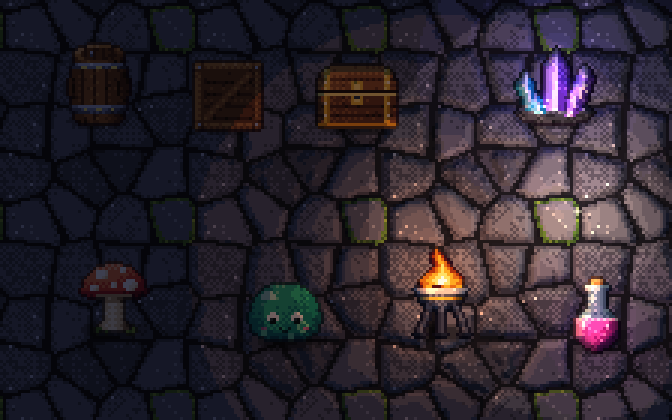

As the light circles around, the sprites shade like 3D objects without any hand-painted normals. Top row: “clay” render (colour removed); bottom row: the real look.

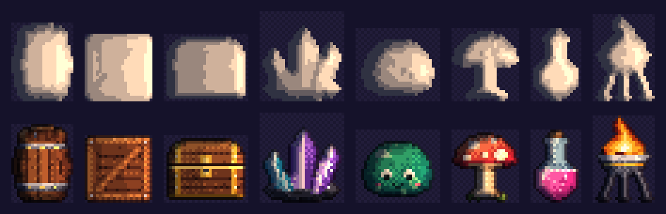

> Every image in this README is rendered by [`tools/render-docs.mjs`](tools/render-docs.mjs) with the same modules the app uses (`node tools/render-docs.mjs`). The sprites and the floor are drawn in code too.

---

## Contents

1. [The big picture: four layers](#1-the-big-picture-four-layers)
2. [The pipeline, step by step](#2-the-pipeline-step-by-step)
3. [A cross-section: how the height is built](#3-a-cross-section-how-the-height-is-built)
4. [The lighting formula](#4-the-lighting-formula)
5. [What each parameter does](#5-what-each-parameter-does)
6. [Common pitfalls](#6-common-pitfalls)
7. [Floor tiles: seamless normal maps](#7-floor-tiles-seamless-normal-maps)
8. [Animation: one map per frame](#8-animation-one-map-per-frame)
9. [Controls](#9-controls) / [Files](#files) / [Tests](#tests)

---

## 1. The big picture: four layers

<table>
<tr><th>Albedo (source art)</th><th>Generated normal map</th></tr>
<tr>
<td></td>
<td>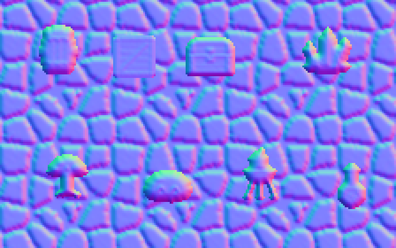</td>
</tr>
<tr><th>Lit with flat normals</th><th>Lit with the normal map</th></tr>
<tr>
<td>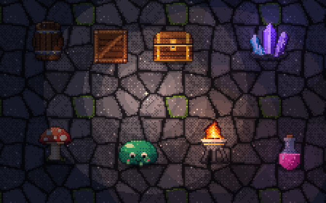</td>
<td>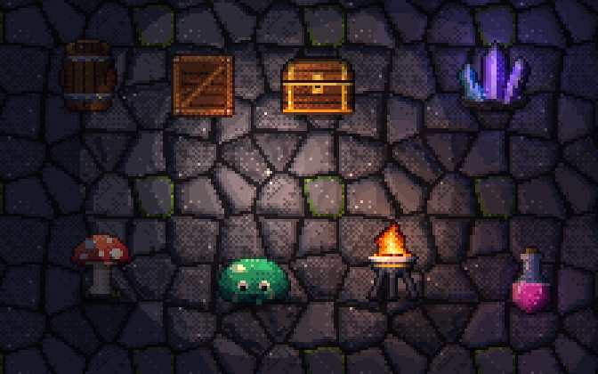</td>
</tr>
</table>

Same light, same spot. Without normals the light is just a glowing disc on top of the picture; with them, **faces turned toward the light brighten and the far sides fall into shadow**, and every floor stone bulges.

Normal-map colours encode **direction**: red = right, green = up, blue = toward the viewer. A flat surface is the pale violet `(128, 128, 255)`.

All sprites (rows: albedo / normal map / clay / lit from the left / lit from the right):


---

## 2. The pipeline, step by step

Here is what happens inside `computeMaps` in [`js/normalmap.js`](js/normalmap.js), using the 22×28 px barrel. Defaults for a ~30 px sprite: `bevel = 5`, `top = 12`, `detail = 1.5`, `σ = 0.7`.

<table>
<tr><th>① Input</th><th>② Mask + 1 px padding</th><th>③ Distance d</th><th>④ r = d / bevel</th></tr>
<tr>
<td></td>
<td></td>
<td></td>
<td></td>
</tr>
<tr><th>⑤ Quarter-circle bevel</th><th>⑥ Brightness detail</th><th>⑦ Total height</th><th>⑧ Blur σ = 0.7</th></tr>
<tr>
<td></td>
<td>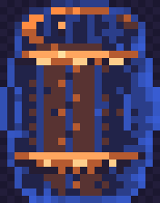</td>
<td>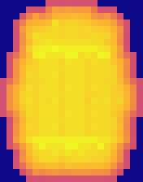</td>
<td></td>
</tr>
<tr><th>⑨ ∂h/∂x</th><th>⑩ ∂h/∂y</th><th>⑪ Normal map</th><th>⑫ Lit</th></tr>
<tr>
<td>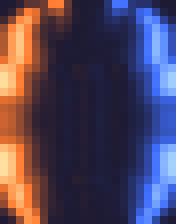</td>
<td></td>
<td>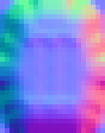</td>
<td></td>
</tr>
</table>

| # | Step | What happens |
| --- | --- | --- |
| ① | Input | An RGBA sprite with hard edges (alpha 0 / 255). |
| ② | **Inside mask** | `alpha > 127` is inside (white). A **transparent 1 px border (red)** is added so the canvas edge also counts as an outline (see [pitfalls](#6-common-pitfalls)). |
| ③ | **Euclidean distance transform** | Exact distance `d` from each inside pixel to the nearest outside pixel: `d = 1` at the rim, brightest in the middle. Implemented with Felzenszwalb & Huttenlocher's lower-envelope-of-parabolas method: two 1-D passes (columns, then rows) give the exact 2-D EDT in linear time, matching SciPy's `distance_transform_edt`. |
| ④ | **Normalise** | `r = clamp(d / bevel, 0, 1)`. Everything more than `bevel` px inside saturates at 1. |
| ⑤ | **Quarter-circle bevel** | `height = top · √(1 − (1 − r)²)`: steep at the rim, a flat plateau inside — a cushion. |
| ⑥ | **Brightness detail** | `detail · (L − mean(L))`, Rec.601 luma `L = (0.299R + 0.587G + 0.114B) / 255`, mean over inside pixels only. Blue = darker than average → **groove**, orange = brighter → **bump**. The barrel's stave seams and iron hoops get their relief here. |
| ⑦ | **Sum** | ⑤ + ⑥, zero outside. |
| ⑧ | **Gaussian blur** | σ = 0.7, radius `⌊4σ + 0.5⌋`, SciPy-style `reflect` borders. Smooths the pixel staircase so normals don't jitter; some height bleeds outward, so normals tilt slightly for 2–3 px outside the outline. |
| ⑨⑩ | **Gradients** | `numpy.gradient` semantics: central differences `(h[x+1] − h[x−1]) / 2` inside, one-sided at borders. Orange = positive, blue = negative. |
| ⑪ | **Normal + encode** | `n = normalize(−∂h/∂x, ∂h/∂y, 1)`, `rgb = round((n · 0.5 + 0.5) · 255)`. Image rows grow downward, so putting `+∂h/∂y` straight into Y makes +Y mean “up” (OpenGL / Godot convention). There is no strength knob: slope comes from `top / bevel` and `detail`. |
| ⑫ | **Lighting** | Lit by a light at the upper left ([section 4](#4-the-lighting-formula)). |

With colour removed (clay render), you can see the outline alone already yields a convincing barrel shape:

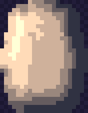

---

## 3. A cross-section: how the height is built

A horizontal slice through row 15 of the barrel. The strip at the bottom shows that row's actual pixels.


- **Dark purple bars** — ⑤ the bevel alone: rising steeply over the outer few pixels, then flat at `top = 12`.
- **Light purple caps** — after adding ⑥ brightness detail: dips at dark seams (black cells in the strip), lifts on bright planks.
- **Orange line** — ⑧ after blurring. Its **slope** is what becomes the normal: flat parts face the viewer, the rim faces outward.

---

## 4. The lighting formula

[`js/lighting.js`](js/lighting.js) does the same math as a Godot `canvas_item` shader's `light()`, per pixel on the CPU (the scene is 224×140, so every frame is cheap).

```
n        = decode(normal)      // rgb/255*2-1, y flipped to screen space
to_light = (light.xy − pixel, light.z)        // z = 26 px (well above top = 12)
falloff  = clamp(1 − |to_light.xy| / radius, 0, 1) ^ 1.2      // radius = 70 px
lit      = falloff · max(dot(n, normalize(to_light)), 0)
lit      = ceil(lit · steps) / steps          // 6 toon bands (0 = smooth)
color    = albedo · (ambient + light_color · energy · lit)
```

Defaults: `ambient = (0.24, 0.25, 0.33)`, `light_color = (1.0, 0.8, 0.56)`, `energy = 1.6`.

How a flat surface (normal facing the viewer) brightens with distance from the light:

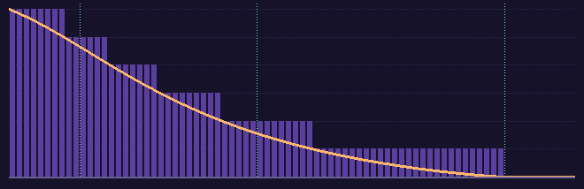

Orange = smooth value, purple bars = quantised with `steps = 6`, green dotted lines = 10 / 35 / 70 px. As in the post's worked examples: **10 px → band 5 of 6 (lit = 0.776), 35 px → band 2, 70 px or more → nothing**. Because of `ceil`, any pixel the light reaches gets at least one band. Quantisation happens in the light, never in the normal map.

<table>
<tr><th colspan="5">Light steps = 0 (smooth) / 2 / 4 / 6 / 12</th></tr>
<tr><td colspan="5"></td></tr>
<tr><th colspan="5">Light height z = 6 / 14 / 26 / 60 px</th></tr>
<tr><td colspan="5"></td></tr>
</table>

A low light (small z) sinks the faces turned away from it into shadow and dims the front faces too; a high light brightens everything evenly and flattens the shading. The post keeps the light well above the plateau: `z = 26` for `top = 12`.

The brazier, crystal and potion carry their own point lights, and the brazier's flame pixels are emissive (they skip lighting).

---

## 5. What each parameter does

Each image shows, top to bottom: **normal map / clay render / final look**.

### bevel = 1 / 3 / 6 / 10 / 16 px (top = 13)
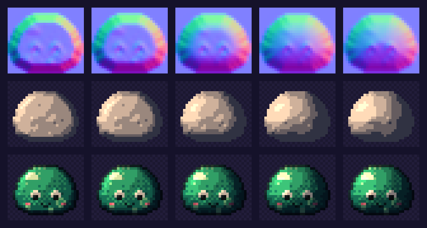

Small: a flat slab with a thin rounded rim. Large: a full dome. Past about half the sprite's thickness, the slope reaches the centre and the plateau disappears.

### top = 3 / 8 / 13 / 24 px (bevel = 6)
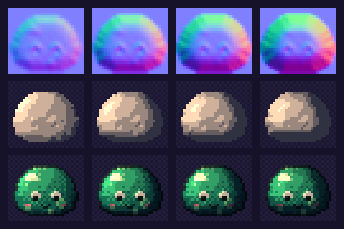

The slope strength: higher means crisper rim shading.

### detail = 0 / 1.5 / 4 / 8
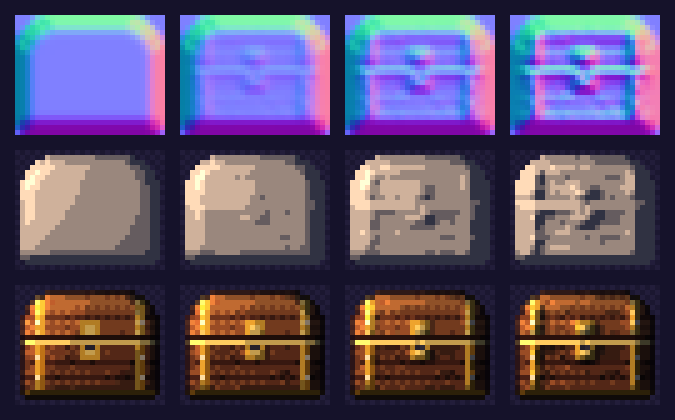

At 0 only the outline is used: a featureless lump. Raising it **engraves the lines inside the art** — plank seams, metal straps, the keyhole. Too high gets noisy.

### σ (blur) = 0 / 0.7 / 1.5 / 2.5
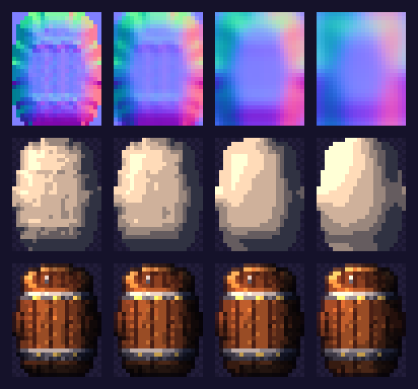

At 0 the pixel staircase shows up as gritty normals; too much blur wipes out the seams.

---

## 6. Common pitfalls

### Sprites touching the canvas edge (left: no padding / right: 1 px padding)


This crate is drawn edge to edge. Without padding, nothing beyond the border counts as “outside”, so **the edges get no bevel** (only the corners tilt a little). The post's barrel lost the bevel on 56 of 702 px. That is why a transparent 1 px border is always added before the distance transform — and why you process **each frame on its own, never a packed sprite sheet**.

### Boxy sprites (left: bevel 5 / top 12, right: boxy rule bevel 1.5 / top 3.6)


The default cushion makes a crate **puff up like a pillow**. For boxes, use a 1–2 px bevel and keep the ratio with `top = 12 · bevel / 5`: only the edges get chamfered (the “Boxy rule” button in the app). The chest uses `bevel 3 / top 7.2`. The post also suggests using brightness alone as height for boxes.

### Green-channel convention (left: correct / right: green flipped)


The light is above. On the right the green channel is inverted (OpenGL vs DirectX convention), so the barrel looks **lit from below**. If you see this, flip the green channel. The app's “Flip green” toggle reproduces it.

---

## 7. Floor tiles: seamless normal maps

A floor is stones and gaps rather than one silhouette, so the outline comes from brightness (`floorMaps`).

<table>
<tr><th>① Source tile (64 px)</th><th>② Tiled 3×3</th><th>③ Stone mask</th></tr>
<tr>
<td></td>
<td></td>
<td></td>
</tr>
<tr><th>④ Height, centre crop</th><th>⑤ Normal map</th><th>⑥ Repeated 2×2 and lit</th></tr>
<tr>
<td>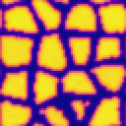</td>
<td>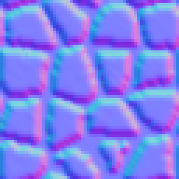</td>
<td>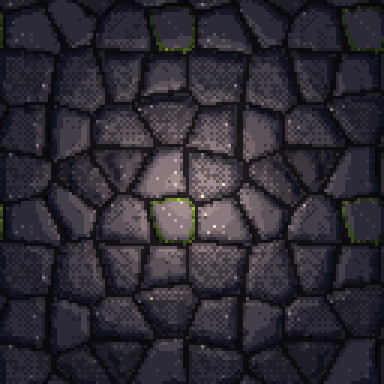</td>
</tr>
</table>

1. The albedo is a seamless wrapped Voronoi tile (gaps where `F2 − F1` is small).
2. **Tile it 3×3** so stones crossing the border stay whole (orange frame = the original tile).
3. Grayscale, then stones (white) = `gaussian(gray, σ=0.8) > 30th percentile of gray`: the darkest 30 % are gaps. Use that as alpha.
4. Run the section-2 pipeline with floor parameters `bevel 3, top 2.5, detail 1.0`, then **crop the centre tile**.
5. The neighbours provide context, so the cropped normal map
6. repeats with no visible seams (the light in the middle straddles the corner where four tiles meet).

---

## 8. Animation: one map per frame

As the post recommends, normal maps are generated **per frame**. The slime (squash) and the brazier (flame) have 4 frames each. Top: albedo, bottom: that frame's normal map.

<table>
<tr><th>Slime</th><th>Brazier</th></tr>
<tr>
<td></td>
<td></td>
</tr>
</table>

When the outline changes, the bevel follows, so a squashed frame gets squashed normals.

---

## 9. Controls

| Input | What it does |
| --- | --- |
| Move the mouse | The light follows the cursor (it orbits by itself when the pointer is off the stage) |
| Drag a sprite | Move it |
| Click | Show that sprite in the side panel and the pipeline inspector (hover a pixel to read d, r, height and normal) |
| Double-click | Place a light (up to 6) |
| View tabs | Lit / Albedo / Normal map / Height / Light only |
| Compare | Render the left half with the flat normal (0,0,1) |
| Flip green | Reproduce the Y-convention mix-up |
| Generation sliders | bevel / top / detail / σ in real time, plus the “Boxy rule” button |
| Load your own PNG | Generate a normal map for any sprite (parameters auto-scale with its size) |
| Save normal / height PNG | Export PNGs ready for a game engine |

No build step. The page uses ES modules, so serve it with any static server:

```bash
node tools/serve.mjs 8765
```

### Using the maps in an engine (from the post)

- **Godot 4**: `Sprite2D` with a `CanvasTexture` (diffuse + normal, Nearest filter), a `canvas_item` shader with the formula above in `light()`, a `PointLight2D` (Height 26, Energy 1.6, warm colour) and a `CanvasModulate` with the ambient colour. Use the same shader on the floor; sprites without a normal map use the flat normal (0,0,1).
- **Unity URP 2D**: a `_NormalMap` secondary texture with a Sprite Custom Lit shader.
- **Scaled-up art**: scale radius, light height, bevel and top by the same factor.

---

## Files

| Path | Role |
| --- | --- |
| [`index.html`](index.html), [`style.css`](style.css) | UI (Japanese / English toggle) |
| [`js/normalmap.js`](js/normalmap.js) | Normal map generation: mask, EDT, bevel, blur, gradient, encoding, floor tiles. DOM-free, runs in Node too |
| [`js/lighting.js`](js/lighting.js) | Point-light shading (same formula as the shader) |
| [`js/sprites.js`](js/sprites.js) | Procedural pixel art: palette ramps, 4×4 Bayer dithering, selective outline, every sprite and the floor |
| [`js/app.js`](js/app.js) | Scene compositing, render loop, dragging and light placement, pipeline inspector, PNG import/export |
| [`tests/check.mjs`](tests/check.mjs) | Checks based on the post's numeric examples |
| [`tools/render-docs.mjs`](tools/render-docs.mjs) | Renders the README images (PNG / animated APNG) with the same modules |
| [`tools/serve.mjs`](tools/serve.mjs) | Tiny static server for local use |

## Tests

```bash
node tests/check.mjs
```

14 checks following the post's numbers: on a round sprite the leftmost pixel has R < 100, the rightmost R > 156, one pixel below the top G > 156; pixels more than 5 px outside are (128,128,255) ±1; a flat pixel 10 px from the light lands in band 5/6 (lit = 0.776), 35 px in band 2/6, 70 px or more gets none; a light on the left brightens the left half; sprites touching the canvas edge still get a bevel; empty frames produce no NaN.

## Credits

- Algorithm: independent implementation of the technique explained in [SpriteCook — Pixel Art Normal Maps from the Outline](https://www.spritecook.ai/blog/pixel-art-normal-maps-from-outline) (no code copied)
- Distance transform: P. Felzenszwalb, D. Huttenlocher, *Distance Transforms of Sampled Functions*, Theory of Computing, 2012
- Pixel fonts: [DotGothic16](https://fonts.google.com/specimen/DotGothic16), [Silkscreen](https://fonts.google.com/specimen/Silkscreen) (Google Fonts)
- Figure colour maps: approximations of matplotlib's magma / plasma

## License

MIT
