# Pixel Art Normal Map Lab

**日本語** | [English](README.en.md)

ピクセルアートの **アウトライン（シルエット）だけ** から法線マップを自動生成し、2D ポイントライトでリアルタイムに照らして確認できるブラウザ用ラボです。
[SpriteCook のブログ記事「Pixel Art Normal Maps from the Outline」](https://www.spritecook.ai/blog/pixel-art-normal-maps-from-outline) で解説されている手法を、依存ライブラリなしの JavaScript で実装しました。

### ▶ デモ: https://kumi0708.github.io/pixel-art-normal-map-lab/


ライトが周りを回ると、手描きの法線なしでも立体として陰影が付きます。上段は色を消した「クレイ（粘土）表示」、下段が実際の見た目です。


> この README の画像はすべて、アプリと同じモジュールを使って [`tools/render-docs.mjs`](tools/render-docs.mjs) で生成しています（`node tools/render-docs.mjs`）。スプライトと床もすべてコードで描いたものです。

---

## 目次

1. [全体像：4 つのレイヤー](#1-全体像4-つのレイヤー)
2. [パイプラインを 1 ステップずつ](#2-パイプラインを-1-ステップずつ)
3. [断面で見る：高さはどう作られるか](#3-断面で見る高さはどう作られるか)
4. [ライティングの式](#4-ライティングの式)
5. [パラメータを変えるとどうなるか](#5-パラメータを変えるとどうなるか)
6. [よくある落とし穴](#6-よくある落とし穴)
7. [床タイル：シームレスな法線マップ](#7-床タイルシームレスな法線マップ)
8. [アニメーション：フレームごとに生成](#8-アニメーションフレームごとに生成)
9. [遊び方](#9-遊び方) / [ファイル構成](#ファイル構成) / [テスト](#テスト)

---

## 1. 全体像：4 つのレイヤー

<table>
<tr>
<th>アルベド（元絵）</th>
<th>生成した法線マップ</th>
</tr>
<tr>
<td>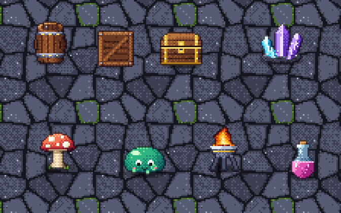</td>
<td></td>
</tr>
<tr>
<th>フラット法線で照らした場合</th>
<th>法線マップで照らした場合</th>
</tr>
<tr>
<td></td>
<td></td>
</tr>
</table>

同じライト位置でも、法線マップがないと「丸い光の円が絵の上に乗っているだけ」になり、法線マップがあると **ライト側の面が明るく、反対側が暗く** なります。床の石も一つずつ盛り上がって見えます。

法線マップの色は **向き** を表しています：赤 = 右向き、緑 = 上向き、青 = 手前向き。平らな面は `(128, 128, 255)` の薄紫です。

全スプライトのまとめ（上から アルベド / 法線マップ / クレイ表示 / 左から照らす / 右から照らす）：

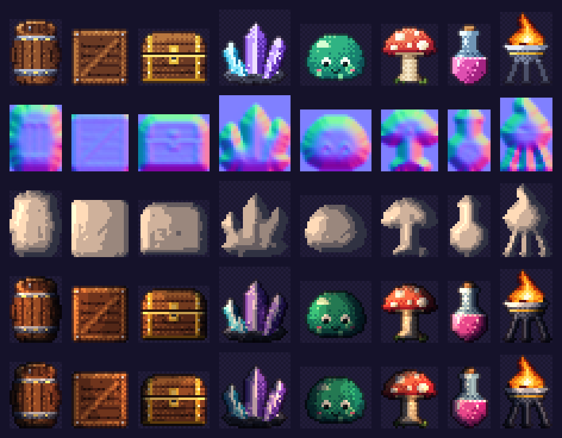

---

## 2. パイプラインを 1 ステップずつ

樽のスプライト（22×28px）を例に、[`js/normalmap.js`](js/normalmap.js) の `computeMaps` の中で何が起きているかを順に見ます。既定値は約 30px のスプライト向けに `bevel = 5`, `top = 12`, `detail = 1.5`, `σ = 0.7`。

<table>
<tr>
<th>① 入力</th><th>② マスク + 1px パディング</th><th>③ 距離 d</th><th>④ r = d / bevel</th>
</tr>
<tr>
<td>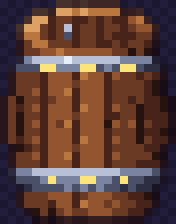</td>
<td>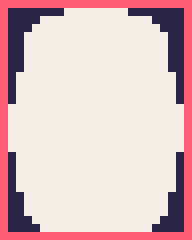</td>
<td>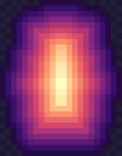</td>
<td>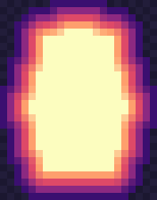</td>
</tr>
<tr>
<th>⑤ 四分円ベベル</th><th>⑥ 明度ディテール</th><th>⑦ 合計の高さ</th><th>⑧ ぼかし σ=0.7</th>
</tr>
<tr>
<td>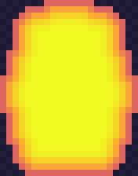</td>
<td></td>
<td></td>
<td>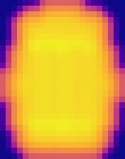</td>
</tr>
<tr>
<th>⑨ ∂h/∂x</th><th>⑩ ∂h/∂y</th><th>⑪ 法線マップ</th><th>⑫ ライティング</th>
</tr>
<tr>
<td></td>
<td>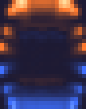</td>
<td></td>
<td>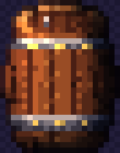</td>
</tr>
</table>

| # | 処理 | 内容 |
| --- | --- | --- |
| ① | 入力 | RGBA のスプライト。ハードエッジ（アルファ 0 / 255）が前提。 |
| ② | **内側マスク** | `alpha > 127` を内側（白）とします。さらに周囲に **透明な 1px（赤い枠）** を足します。これでキャンバスの端も「輪郭」として扱われます（[落とし穴](#6-よくある落とし穴) 参照）。 |
| ③ | **ユークリッド距離変換** | 内側の各画素から、一番近い外側画素までの正確な距離 `d`。縁は `d = 1`、中心ほど明るい。Felzenszwalb & Huttenlocher の「放物線の下側エンベロープ」法で、列方向 → 行方向の 1 次元変換 2 回で厳密な 2D 距離を O(画素数) で求めます（SciPy の `distance_transform_edt` と同じ結果）。 |
| ④ | **正規化** | `r = clamp(d / bevel, 0, 1)`。縁から `bevel` px 以上内側はすべて 1（白飛び部分）になります。 |
| ⑤ | **四分円ベベル** | `height = top · √(1 − (1 − r)²)`。縁で急に立ち上がり、内側は平らな天板になる「クッション」形。 |
| ⑥ | **明度ディテール** | `detail · (L − mean(L))`。`L` は Rec.601 輝度 `(0.299R + 0.587G + 0.114B) / 255`、平均は内側画素だけで計算。青 = 平均より暗い → **溝**、オレンジ = 明るい → **盛り上がり**。樽の板の継ぎ目や鉄のタガがここで凹凸になります。 |
| ⑦ | **合計** | ⑤ + ⑥、外側は 0。 |
| ⑧ | **ガウスぼかし** | σ = 0.7、半径 `⌊4σ + 0.5⌋`、境界は SciPy と同じ `reflect`。ピクセルの階段をならして法線のガタつきを防ぎます。外側にも少しにじむので、法線は輪郭の 2〜3px 外まで少し傾きます。 |
| ⑨⑩ | **勾配** | `numpy.gradient` と同じ：内部は中心差分 `(h[x+1] − h[x−1]) / 2`、端は片側差分。オレンジ = 正、青 = 負。 |
| ⑪ | **法線 + エンコード** | `n = normalize(−∂h/∂x, ∂h/∂y, 1)`、`rgb = round((n · 0.5 + 0.5) · 255)`。画像の行は下向きに増えるので、`+∂h/∂y` をそのまま Y に入れると +Y が「上」になります（OpenGL / Godot 規約）。強さの専用パラメータはなく、傾きは `top / bevel` と `detail` で決まります。 |
| ⑫ | **ライティング** | 左上のライトで照らした結果（[4 章](#4-ライティングの式)）。 |

色を消して陰影だけを見ると（クレイ表示）、輪郭だけからちゃんと「樽の形」が出ているのがわかります：


---

## 3. 断面で見る：高さはどう作られるか

樽の 15 行目を横に切った断面です。下の色帯がその行の実際のピクセル。

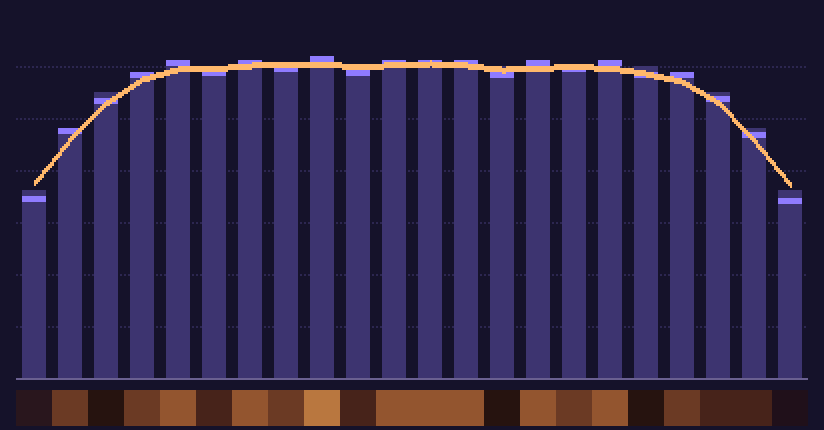

- **濃い紫の棒** … ⑤ 四分円ベベルだけの高さ。両端の数 px で急に立ち上がり、内側は `top = 12` で平ら。
- **明るい紫の線** … ⑥ 明度ディテールを足した高さ。暗い継ぎ目（色帯の黒い所）でわずかに下がり、明るい板で上がる。
- **オレンジの線** … ⑧ ぼかした後の高さ。この **傾き** が法線になります。平らな所は正面を向き、縁では大きく外側を向きます。

---

## 4. ライティングの式

[`js/lighting.js`](js/lighting.js) は Godot の `canvas_item` シェーダの `light()` と同じ計算を CPU で 1 画素ずつ行っています（224×140 のシーンなので毎フレームでも軽い）。

```
n        = decode(normal)      // rgb/255*2-1、画面座標に合わせて y を反転
to_light = (light.xy − pixel, light.z)        // z = 26px（top=12 より十分高く）
falloff  = clamp(1 − |to_light.xy| / radius, 0, 1) ^ 1.2      // radius = 70px
lit      = falloff · max(dot(n, normalize(to_light)), 0)
lit      = ceil(lit · steps) / steps          // steps = 6 のトゥーン階調（0 でなめらか）
color    = albedo · (ambient + light_color · energy · lit)
```

既定値: `ambient = (0.24, 0.25, 0.33)`, `light_color = (1.0, 0.8, 0.56)`, `energy = 1.6`

平らな面（法線 = 正面）がライトからの距離でどう明るくなるか：


オレンジ線がなめらかな値、紫の棒が `steps = 6` で量子化した値、緑の点線が距離 10 / 35 / 70px。記事の数値例どおり **10px で 6 段階中 5 段階目（lit = 0.776）、35px で 2 段階目、70px 以上で 0** になります。`ceil` なので、少しでも光が届けば最低 1 段階明るくなります。量子化はライト側で行い、法線マップ自体は量子化しません。

<table>
<tr><th colspan="5">階調ステップ steps = 0（なめらか）/ 2 / 4 / 6 / 12</th></tr>
<tr><td colspan="5">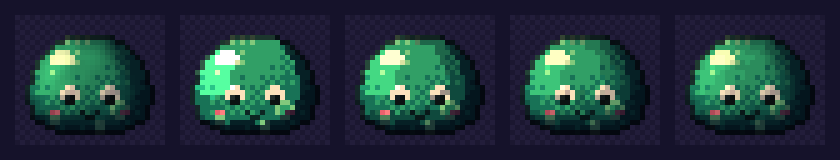</td></tr>
<tr><th colspan="5">ライトの高さ z = 6 / 14 / 26 / 60 px</th></tr>
<tr><td colspan="5">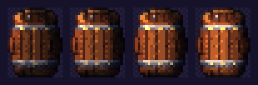</td></tr>
</table>

ライトが低い（z が小さい）と、ライトと反対側を向いた面が暗く沈み、正面の面も暗くなります。高いほど全体が均一に明るくなり、陰影は弱まります。記事では `top = 12` に対して `z = 26` と、天板より十分高く置くことを勧めています。

火鉢・クリスタル・ポーションは自前のポイントライトを持ち、火鉢の炎の画素は「発光（emissive）」としてライティングを無視して描画しています。

---

## 5. パラメータを変えるとどうなるか

各画像は上から **法線マップ / クレイ表示 / 実際の見た目**。

### bevel（ベベル幅）= 1 / 3 / 6 / 10 / 16 px（top = 13）


小さいと縁だけが細く丸まった「平らな板」、大きいと全体が丸いドーム。スプライトの太さの半分くらいを超えると、中央まで傾斜が続いて天板がなくなります。

### top（頂上の高さ）= 3 / 8 / 13 / 24 px（bevel = 6）


傾斜の強さ。高いほど縁の陰影がくっきりします。

### detail（明度ディテール）= 0 / 1.5 / 4 / 8


0 だと輪郭しか使わないのっぺりした塊。上げると、板の継ぎ目・金具・鍵穴など **絵の中の線が彫り込まれます**。上げすぎるとノイズっぽくなります。

### σ（ぼかし）= 0 / 0.7 / 1.5 / 2.5


0 だとピクセル単位の階段がそのまま法線に出てザラつき、大きすぎると継ぎ目のディテールが消えます。

---

## 6. よくある落とし穴

### キャンバスの端に接したスプライト（左: パディングなし / 右: 1px パディングあり）
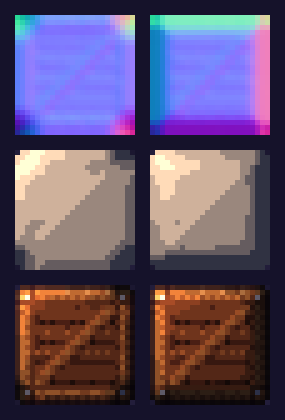

この木箱は画像の端いっぱいまで描かれています。パディングなしだと、端の外側が「外」として扱われないので **端の辺にベベルが付きません**（四隅がわずかに傾くだけ）。記事の樽の例では 702px 中 56px でベベルが欠けていました。だから距離変換の前に必ず透明な 1px を足します。同じ理由で、**パックしたスプライトシートには直接かけず、フレームを 1 枚ずつ処理** します。

### 箱型のスプライト（左: bevel 5 / top 12 / 右: 箱型ルール bevel 1.5 / top 3.6）
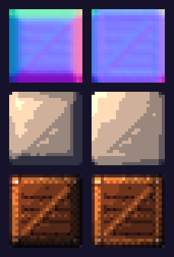

既定のクッション形だと、木箱が **枕のように膨らんで** 見えます。箱は `bevel` を 1〜2px にして `top = 12 · bevel / 5` で比率を保つと、縁だけ面取りされた箱らしい形になります（アプリの「箱型ルール」ボタン）。宝箱は `bevel 3 / top 7.2` にしています。明るさだけを高さにする方法も記事で紹介されています。

### 緑チャンネルの規約（左: 正しい / 右: 緑を反転）
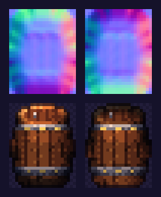

ライトは上にあります。右は緑チャンネルが逆（OpenGL ⇔ DirectX の規約違い）なので、**下から照らされているように** 見えます。こうなったら緑を反転します。アプリの「緑チャンネル反転」で再現できます。

---

## 7. 床タイル：シームレスな法線マップ

床はスプライトと違って「石と目地」なので、輪郭を明るさから作ります（`floorMaps`）。

<table>
<tr>
<th>① 元のタイル (64px)</th><th>② 3×3 に並べる</th><th>③ 石のマスク</th>
</tr>
<tr>
<td>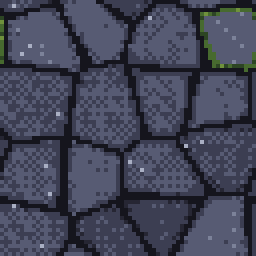</td>
<td>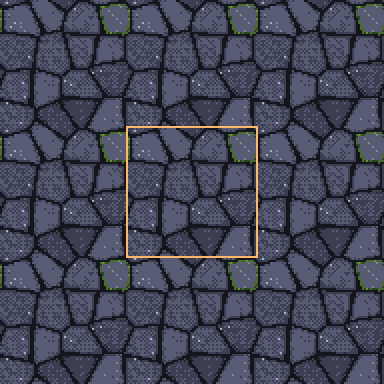</td>
<td>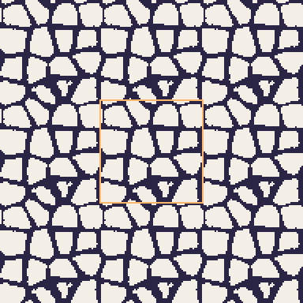</td>
</tr>
<tr>
<th>④ 中央を切り出した高さ</th><th>⑤ 法線マップ</th><th>⑥ 2×2 に並べて照らす</th>
</tr>
<tr>
<td></td>
<td></td>
<td></td>
</tr>
</table>

1. 元絵はラップアラウンドするボロノイ（`F2 − F1` が小さい所が目地）で生成したシームレスなタイル。
2. **3×3 に並べる**。端をまたぐ石が欠けないようにするためです（オレンジ枠が元のタイル）。
3. グレースケールにして `gaussian(gray, σ=0.8) > gray の 30 パーセンタイル` を石（白）にします。暗い 30% が目地。これをアルファとして使います。
4. 床用パラメータ `bevel 3, top 2.5, detail 1.0` で 2 章と同じ処理をして、**中央のタイルだけ切り出します**。
5. 周囲のタイルが文脈になるので、切り出した法線マップは
6. 並べても継ぎ目が見えません（中央のライトが 4 枚のタイルの境目をまたいでいます）。

---

## 8. アニメーション：フレームごとに生成

記事の推奨どおり、法線マップは **各フレームを個別に** 生成しています。スライム（伸び縮み）と火鉢（炎）は 4 フレームずつ。上段がアルベド、下段がそのフレームの法線マップです。

<table>
<tr><th>スライム</th><th>火鉢</th></tr>
<tr>
<td>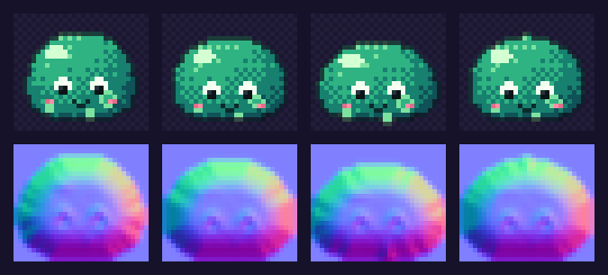</td>
<td>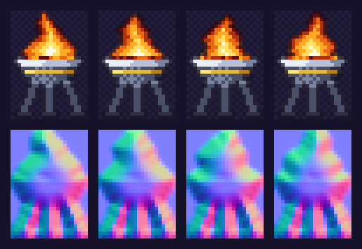</td>
</tr>
</table>

輪郭が変わればベベルも変わるので、つぶれたフレームでは法線もつぶれています。

---

## 9. 遊び方

| 操作 | 内容 |
| --- | --- |
| マウス移動 | ライトがカーソルに追従（ステージ外ではライトが自動で周回） |
| スプライトをドラッグ | 移動 |
| クリック | 右パネルとパイプライン可視化にそのスプライトを表示（ピクセルにカーソルを当てると d・r・高さ・法線の値を表示） |
| ダブルクリック | その場所にライトを置く（最大 6 個） |
| 表示切替 | ライティング / アルベド / 法線マップ / 高さ / ライトのみ |
| 左半分をフラット法線で比較 | 画面の左半分だけ法線 (0,0,1) で描画 |
| 緑チャンネル反転 | Y 軸規約の取り違えを再現 |
| 生成パラメータ | bevel / top / detail / σ をリアルタイムに変更、「箱型ルール」ボタン |
| 自分の PNG を読み込む | 任意のスプライトから法線マップを生成（パラメータはサイズに合わせて自動スケール） |
| 法線マップ / 高さマップ PNG を保存 | そのままゲームエンジンで使える PNG を出力 |

ローカルで動かす場合はビルド不要です。ES Modules を使っているので静的サーバーで開いてください。

```bash
node tools/serve.mjs 8765
```

### ゲームエンジンで使うには（記事より）

- **Godot 4**: `Sprite2D` に `CanvasTexture`（diffuse + normal、フィルタは Nearest）、上の式を `light()` に書いた `canvas_item` シェーダ、`PointLight2D`（Height 26, Energy 1.6, 暖色）と環境光色の `CanvasModulate`。床にも同じシェーダを。法線マップのないスプライトはフラット法線 (0,0,1)。
- **Unity URP 2D**: `_NormalMap` セカンダリテクスチャ + Sprite Custom Lit シェーダ。
- **拡大表示のとき**: radius・ライトの高さ・bevel・top を同じ倍率でスケールします。

---

## ファイル構成

| パス | 役割 |
| --- | --- |
| [`index.html`](index.html), [`style.css`](style.css) | UI（日本語 / 英語切替） |
| [`js/normalmap.js`](js/normalmap.js) | 法線マップ生成：マスク、EDT、ベベル、ぼかし、勾配、エンコード、床タイル。DOM 非依存で Node からも使える |
| [`js/lighting.js`](js/lighting.js) | ポイントライトのシェーディング（シェーダと同じ式） |
| [`js/sprites.js`](js/sprites.js) | 手続き的ピクセルアート：パレットランプ、4×4 ベイヤーディザ、セレクティブアウトライン、各スプライトと床 |
| [`js/app.js`](js/app.js) | シーン合成、描画ループ、ドラッグ・ライト配置、パイプライン可視化、PNG 入出力 |
| [`tests/check.mjs`](tests/check.mjs) | 記事の数値例に基づく検証 |
| [`tools/render-docs.mjs`](tools/render-docs.mjs) | README の画像（PNG / アニメーション APNG）を同じモジュールで生成 |
| [`tools/serve.mjs`](tools/serve.mjs) | ローカル用の小さな静的サーバー |

## テスト

```bash
node tests/check.mjs
```

記事の数値例を確認しています：丸いスプライトの左端は R < 100・右端は R > 156・上端の 1px 内側は G > 156、輪郭から 5px 以上外側は (128,128,255) ±1、フラットな面はライトから 10px で 5/6 段（lit = 0.776）・35px で 2/6 段・70px 以上で 0、左からのライトでは左半分が明るい、キャンバス端に接していてもベベルが付く、空フレームで NaN にならない、など 14 項目。

## クレジット

- アルゴリズム: [SpriteCook — Pixel Art Normal Maps from the Outline](https://www.spritecook.ai/blog/pixel-art-normal-maps-from-outline) の解説に基づく独自実装（コードの流用はしていません）
- 距離変換: P. Felzenszwalb, D. Huttenlocher, *Distance Transforms of Sampled Functions*, Theory of Computing, 2012
- ドット絵フォント: [DotGothic16](https://fonts.google.com/specimen/DotGothic16), [Silkscreen](https://fonts.google.com/specimen/Silkscreen)（Google Fonts）
- 図のカラーマップ: magma / plasma（matplotlib のカラーマップを近似）

## ライセンス

MIT
