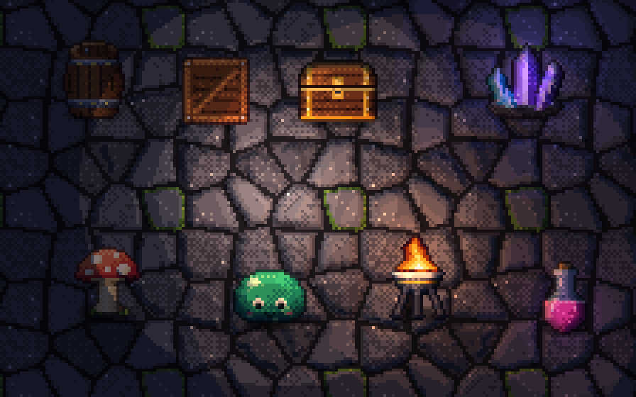
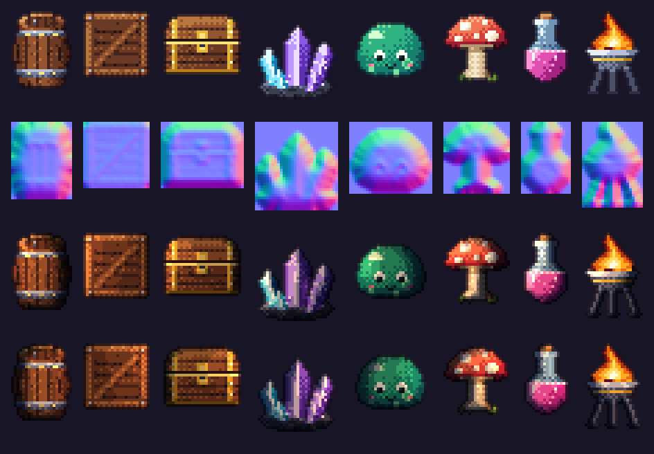

# Pixel Art Normal Map Lab

**日本語** | [English](README.en.md)

ピクセルアートの **アウトライン（シルエット）だけ** から法線マップを自動生成し、2D ポイントライトでリアルタイムに照らして確認できるブラウザ用ラボです。
[SpriteCook のブログ記事「Pixel Art Normal Maps from the Outline」](https://www.spritecook.ai/blog/pixel-art-normal-maps-from-outline) で解説されている手法を、依存ライブラリなしの JavaScript で実装しました。

### ▶ デモ: https://kumi0708.github.io/pixel-art-normal-map-lab/



上から順に「アルベド（元絵）」「生成した法線マップ」「左から照らした結果」「右から照らした結果」：



スプライト（樽・木箱・宝箱・クリスタル・スライム・キノコ・ポーション・火鉢）と石畳の床は、すべてコードで描いています（パレットのランプ＋4×4 ディザ＋セレクティブアウトライン）。

---

## 遊び方

| 操作 | 内容 |
| --- | --- |
| マウス移動 | ライトがカーソルに追従（ステージ外ではライトが自動で周回） |
| スプライトをドラッグ | 移動 |
| クリック | 右パネルとパイプライン可視化にそのスプライトを表示 |
| ダブルクリック | その場所にライトを置く（最大 6 個） |
| 表示切替 | ライティング / アルベド / 法線マップ / 高さ / ライトのみ |
| 左半分をフラット法線で比較 | 画面の左半分だけ法線 (0,0,1) で描画し、法線マップの有無を見比べる |
| 緑チャンネル反転 | エンジン間の Y 軸規約の違い（OpenGL / DirectX）を間違えたときの見え方を再現 |
| 自分の PNG を読み込む | 任意のスプライトから法線マップを生成（パラメータはサイズに合わせて自動スケール） |
| 法線マップ / 高さマップ PNG を保存 | そのままゲームエンジンで使える PNG を出力 |

ローカルで動かす場合はビルド不要です。ES Modules を使っているので、静的サーバーで開いてください。

```bash
node tools/serve.mjs 8765
```

---

## 技術解説

処理は「① 高さマップを作る → ② 法線にする → ③ ライティングする」の 3 段階です。アートは 1 枚も手描きの法線を必要とせず、**輪郭からの距離** と **明るさ** だけで立体感を作ります。

### ① 輪郭から高さマップを作る（[`js/normalmap.js`](js/normalmap.js) の `computeMaps`）

既定値は約 30px のスプライト向けに `bevel = 5`, `top = 12`, `detail = 1.5`。

1. **内側マスク** — アルファ > 127 の画素を「内側」とみなします。半透明のフチはここで二値化されるので、アルファがギザギザだとベベルの位置もずれます（ハードエッジ推奨）。
2. **1px のパディング** — マスクの周りに透明な 1px を足してから距離変換します。これをしないと、キャンバスの端に接しているスプライトはその辺にベベルが付きません（記事の樽では 702px 中 56px が欠けた例が挙がっています）。
3. **ユークリッド距離変換 (EDT)** — 内側の各画素について、最も近い外側画素までの正確なユークリッド距離 `d` を求めます。実装は Felzenszwalb & Huttenlocher の「放物線の下側エンベロープ」法で、列方向 → 行方向の 1 次元変換 2 回で厳密な 2 次元 EDT が O(画素数) で得られます（SciPy の `distance_transform_edt` と同じ結果）。縁に接する画素は `d = 1`。
4. **四分円ベベル** — `r = clamp(d / bevel, 0, 1)`、`height = top · √(1 − (1 − r)²)`。縁 (r=0) で傾きが最大、`bevel` px 以上内側では平らな天板 (`top`) になる、クッション状の断面です。
5. **明るさディテール** — `height += detail · (L − mean(L))`。`L = (0.299R + 0.587G + 0.114B) / 255`（Rec.601 輝度）で、平均は内側画素のみ。平均を引くので全体の高さは変わらず、暗い線（板の継ぎ目、輪郭線）は溝に、明るいハイライトはわずかな盛り上がりになります。内側が 0 画素のフレームでも NaN にならないようガードしています。
6. **外側を 0 に** してから **ガウスぼかし σ = 0.7**（分離可能カーネル、半径 `⌊4σ + 0.5⌋`、境界は SciPy と同じ `reflect`）。ピクセル単位の階段をならし、法線が 1px ごとにガタつくのを防ぎます。外側にもわずかに滲むので、法線マップは輪郭の外 2〜3px まで少し傾きます（5px 以上離れると完全にフラット）。

### ② 高さ → 法線（同ファイル）

7. **勾配** — `numpy.gradient` と同じく内部は中心差分 `(h[x+1] − h[x−1]) / 2`、端は片側差分。
8. **法線** — `n = normalize(−∂h/∂x, ∂h/∂y, 1)`。画像の行は下向きに増えるので、`+∂h/∂y` をそのまま入れると「上向き」が +Y になります（OpenGL / Godot 規約）。強さの専用パラメータはなく、傾きは `top / bevel` と `detail` で決まります。
9. **エンコード** — `rgb = round((n · 0.5 + 0.5) · 255)`。平らな面は `(128, 128, 255)`。出力はスプライトと同じサイズの PNG。ライトが下から当たっているように見えたら、エンジン側が DirectX 規約なので緑チャンネルを反転します（アプリの「緑チャンネル反転」で再現できます）。

**箱型のスプライト**（木箱など）はクッション形だと枕のように見えるので、`bevel` を 1〜2px にし、`top = 12 · bevel / 5` で比率を保ちます（右パネルの「箱型ルール」ボタン）。木箱は `bevel 1.5, top 3.6`、宝箱は `bevel 3, top 7.2` にしています。

### ③ ライティング（[`js/lighting.js`](js/lighting.js)）

Godot の `canvas_item` シェーダの `light()` で行う計算を CPU で 1 画素ずつ実行しています（224×140 のシーンなので毎フレームでも軽い）。

```
n        = decode(normal)      // rgb/255*2-1、画面座標に合わせて y を反転
to_light = (light.xy − pixel, light.z)        // z = 26px（top=12 より十分高く）
falloff  = clamp(1 − |to_light.xy| / radius, 0, 1) ^ 1.2      // radius = 70px
lit      = falloff · max(dot(n, normalize(to_light)), 0)
lit      = ceil(lit · steps) / steps          // steps = 6 のトゥーン階調（0 でなめらか）
color    = albedo · (ambient + light_color · energy · lit)
```

既定値は `ambient = (0.24, 0.25, 0.33)`、`light_color = (1.0, 0.8, 0.56)`、`energy = 1.6`。`ceil` を使うので、少しでも光が届く画素は最低 1 段階明るくなります。量子化はライト側で行い、法線マップ自体は量子化しません。
火鉢・クリスタル・ポーションは自前のポイントライトを持ち、火鉢の炎の画素は「発光（emissive）」としてライティングを無視して描画しています。

### 床タイル（`floorMaps`）

床はスプライトと違って「石と目地」なので、輪郭を明るさから作ります。

1. タイルを **3×3 に並べる**（端をまたぐ石が欠けないように）。
2. グレースケール化し、`gaussian(gray, σ=0.8) > gray の 30 パーセンタイル` を石のマスク（= アルファ）にする。つまり暗い 30% が目地。
3. 床用パラメータ `bevel 3, top 2.5, detail 1.0` で ①② を実行し、**中央のタイルだけ切り出す**。周囲のタイルが文脈になるので、切り出した法線マップも継ぎ目なくタイリングできます。

石畳の元絵自体も、ラップアラウンドするボロノイ（F2 − F1 で目地を判定）で生成したシームレスなタイルです。

### アニメーション

記事の注意点どおり、**法線マップはフレームごとに個別に生成** しています（スライムの伸縮・火鉢の炎は 4 フレーム）。パックしたスプライトシートにまとめて距離変換をかけると、隣のフレームとの境界がぼやけたり、シート端のフレームにベベルが付かなかったりします。

---

## ファイル構成

| パス | 役割 |
| --- | --- |
| [`index.html`](index.html), [`style.css`](style.css) | UI（日本語 / 英語切替） |
| [`js/normalmap.js`](js/normalmap.js) | 法線マップ生成：マスク、EDT、ベベル、ぼかし、勾配、エンコード、床タイル。DOM 非依存で Node からも使える |
| [`js/lighting.js`](js/lighting.js) | ポイントライトのシェーディング（シェーダと同じ式） |
| [`js/sprites.js`](js/sprites.js) | 手続き的ピクセルアート：パレットランプ、ベイヤーディザ、セレクティブアウトライン、各スプライトと床 |
| [`js/app.js`](js/app.js) | シーン合成、描画ループ、ドラッグ・ライト配置、パイプライン可視化、PNG 入出力 |
| [`tests/check.mjs`](tests/check.mjs) | 記事の数値例に基づく検証 |
| [`tools/render-docs.mjs`](tools/render-docs.mjs) | README の画像を同じモジュールで生成 |
| [`tools/serve.mjs`](tools/serve.mjs) | ローカル用の小さな静的サーバー |

## テスト

```bash
node tests/check.mjs
```

記事に載っている数値例を確認しています：丸いスプライトの左端は R < 100・右端は R > 156・上端の 1px 内側は G > 156、輪郭から 5px 以上外側は (128,128,255) ±1、フラットな面はライトから 10px で 6 段階中 5 段階目（lit = 0.776）、35px で 2 段階目、70px 以上で 0、左からのライトでは左半分が明るい、キャンバス端に接していてもベベルが付く、空フレームで NaN にならない、など。

## クレジット

- アルゴリズム: [SpriteCook — Pixel Art Normal Maps from the Outline](https://www.spritecook.ai/blog/pixel-art-normal-maps-from-outline) の解説に基づく独自実装（コードの流用はしていません）
- 距離変換: P. Felzenszwalb, D. Huttenlocher, *Distance Transforms of Sampled Functions*, Theory of Computing, 2012
- ドット絵フォント: [DotGothic16](https://fonts.google.com/specimen/DotGothic16), [Silkscreen](https://fonts.google.com/specimen/Silkscreen)（Google Fonts）

## ライセンス

MIT
